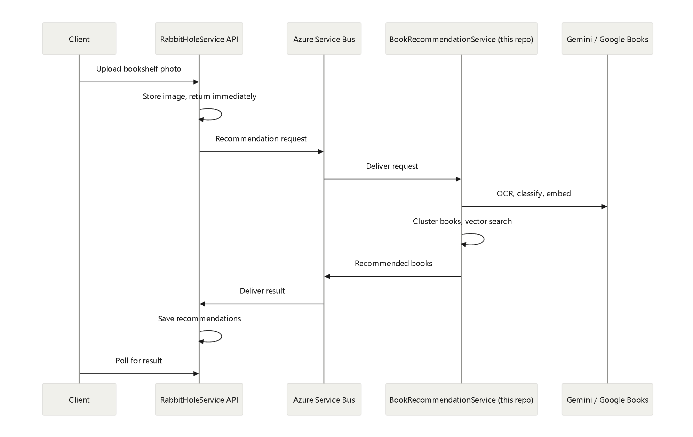

# BookRecommendationService

A message-queue worker that identifies books from a bookshelf photo (using Gemini), groups similar books into clusters, and recommends new books using vector similarity search. The clustering uses a custom sequential leader-follower algorithm.
This worker is the companion to the [RabbitHoleService API](https://github.com/calvia17/BookstoreAPI). See that repo for the full system architecture.

## Purpose

Traditional recommenders rely on other users' purchases, ratings or history. This service recommends books based on the content of the books on a user's own shelf, so it works even for a user who has never bought anything from the store.

It also improves on the alternatives:

- Genre filtering alone is too broad and ignores the user's own taste within a genre.
- Tag matching alone is unreliable, because different tags are often applied to similar books, and strict matching misses them.

Embeddings capture similarity in meaning, so the service can find books with similar themes even when their tags differ, and it can distinguish preferences within a single genre.

## Architecture

1. The worker service receives a message from the API with the image URL and correlation ID (using Azure Service Bus).
2. The worker downloads the image from Azure Blob Storage and validates it.
3. Identify books (OCR): Gemini extracts titles and authors from the shelf photo. It handles different fonts, orientations and languages, and separates multiple books in a single photo.
4. Classify: Gemini assigns each book descriptive tags, a broad genre group and a book type (novel, manga, etc.).
5. Embed: An embedding is generated from the title, author, summary and Gemini tags. Summaries come from the Google Books API.
6. Cluster: The shelf's embeddings are grouped with the sequential leader-follower algorithm.
7. Vector Similarity Search: Each cluster is searched against the stored book embeddings by cosine distance, filtered by genre group and book type.
8. Reply: The recommendations are sent back to the API through a queue.



### Why genre group and book type are used as filters

Embeddings capture thematic similarity, so without filters a book with similar themes in a different genre group or book type would be recommended. 
Users usually prefer to stay within the same genre groups and book types, so those two fields act as hard filters. 
The goal is better recommendations within a user's preferred categories, not across them.

## Message queues

The worker and the API communicate only through Azure Service Bus queues, so neither needs the other to be online at the same moment.

The worker handles two kinds of incoming messages:

- Book changes (added, updated, deleted) from the API, which keep the worker's own book database in sync.
- Recommendation requests, which it processes and answers with the recommended books.

Benefits of using queues here:

- Decoupling: the worker runs independently of the API, which helps scalability and fault tolerance.
- Asynchronous processing: the worker handles messages at its own pace. This matters because computing recommendations calls external APIs (Gemini, Google Books) that can be slow, and the API shouldn't block on them.
- Reliability: messages aren't lost if either service is briefly down.
- Retries: failed messages can be retried, so they are eventually processed.

## Recommendation algorithm

### Vector similarity

Each embedding is a vector in high-dimensional space. A vector's length carries no meaning for similarity, its direction does. The smaller the angle between two vectors, the more similar the books.

- Cosine similarity is the cosine of the angle between two vectors.
- Cosine distance = 1 − cosine similarity. Smaller means more similar. The range is 0 to 2 (2 at 180°, where the cosine is −1).
- At 90°, two vectors share no direction, so the books are unrelated.

### Approaches considered

- Minimum distance: Compute the distance from every stored book to each input book, and keep each stored book's smallest distance.
    - Advantage: Never recommends a book far from every input book.
    - Disadvantage: Ignores the overall taste profile. A shelf with 5 fantasy books and 1 mystery book weighs them equally.
      It can recommend more mystery books if it finds better matches ignoring the user's dominant taste.
- Centroid: Take the centroid of all input embeddings and search around it.
    - Advantage: Reflects the overall taste profile. A shelf with 5 fantasy books and 1 mystery book will have a centroid closer to fantasy books, so it will recommend more fantasy books.
    - Disadvantage: If the shelf is half fantasy, half mystery, the centroid lands between them and recommends books weakly related to both.
- Hybrid: Use the minimum approach to get a larger candidate set, then rank it by distance to the centroid.
    - Advantages:
        - It keeps the minimum approach’s guarantee of not recommending books far from every input book, while also considering the overall taste profile.
        - It will result in fewer database calls and thus better performance than the minimum approach.
    - Disadvantage: It can recommend books from the filtered list that are close to the centroid, ignoring books that may be very close to one input book.
- Clustering: Group the input books into clusters, and take the centroid of each cluster to search for recommendations.
    - Advantages:
        - The centroid is more representative of the books in the cluster, so the recommendations will find books very close to the cluster rather than a global centroid of all the books.
        - It will result in fewer database calls and thus better performance than the minimum approach.
    - Clustering Algorithms:
        - K-means: Group books into k clusters and search each centroid.
            - Advantage: Fewer database queries.
            - Disadvantage: Accuracy depends on k. Centroids can point to books unlike those in the cluster.
              If k is too small and the books are very distinct, the cluster centroid can point to very different books than those in the cluster.
              Even if k is large and all the books are distinct, the cluster centroid can point to books that are not in the cluster.
        - Leader-follower (used): Cluster books in one pass using a distance threshold.
            - The first book added to a cluster becomes the leader of that cluster.
              We add a book to an existing cluster if the distance to the leader of that cluster is below the threshold.
              Otherwise, a new cluster is created with that book as the leader.
              Since the leader is always a book in the cluster, it will always be representative of the books in that cluster.
            - Advantages:
                - Fast when books are similar, accurate when they are distinct.
                - If the shelf has groups of similar books (for example five Harry Potter books), the whole group needs only one search instead of five.
            - Disadvantages:
                - Needs a well-chosen threshold.
                - If the shelf is very distinct, there will be many small clusters, which costs some performance but keeps accuracy.
    - To represent taste profiles, we choose m books representative of each cluster where m = (number of books in the cluster / total number of books in the shelf) * number of books to recommend.
    - A user with 5 fantasy books and 1 mystery book therefore gets mostly fantasy recommendations. Without clusters, a large number of closely related mystery books in the database could crowd out the fantasy results.

### Performance Improvements

- Parallel processing
- SIMD-accelerated distance calculations
- Embeddings cached in Redis to reduce external API calls

## Tech stack
- Runtime: .NET 10 worker service
- Messaging: Azure Service Bus (queues)
- AI: Gemini (OCR, classification, embeddings)
- Book data: Google Books API (summaries)
- Caching: Redis (distributed cache for embeddings)
- Database: SQL Server
- Image storage: Azure Blob Storage
- Book Seeding: Open Library API

## Running locally

### Prerequisites

- .NET 10 SDK
- Redis
- An Azure Service Bus namespace with the two queues the API uses (request and reply)
- A Gemini API key
- A Google Books API key
- Access to the same Blob Storage account as the API
- The [RabbitHoleService API](https://github.com/calvia17/BookstoreAPI) running, so there is something to send requests

### Steps

1. Clone the repository.
2. Add the project secrets

   ```
   cd BookRecommendationService
   dotnet user-secrets set "ServiceBus:ConnectionString" "<Service Bus connection string>"
   dotnet user-secrets set "ServiceBus:ProcessQueueName" "<process queue name>"
   dotnet user-secrets set "ServiceBus:PublishQueueName" "<publish queue name>"
   dotnet user-secrets set "Gemini:ApiKey" "<Gemini API key>"
   dotnet user-secrets set "GoogleBooks:ApiKey" "<Google Books API key>"
   dotnet user-secrets set "ConnectionStrings:Redis" "<Redis connection string>"
   dotnet user-secrets set "ConnectionStrings:DefaultConnection" "<database connection string>"
   dotnet user-secrets set "BlobStorage:ConnectionString" "<Blob Storage connection string>"
   dotnet user-secrets set "BlobStorage:ShelfImageContainer" "<Blob Storage container name>"
   dotnet user-secrets set "BlobStorage:StorageHost" "<storage-account-name>.blob.core.windows.net"
   ```

3. Create the database: `dotnet ef database update`
4. Run the worker: `dotnet run`

## Seeding the worker's book data

The worker keeps its own copy of the book catalogue, which is kept in sync through queue messages. The easiest way to populate it is to run the API's BookSeeder tool (see the [API README](https://github.com/calvia17/BookstoreAPI)).

## Deployment

The worker is not currently deployed. The hosted API runs on the Azure App Service F1 (free) tier, which has no Always On, so the app is unloaded when idle and cannot run a reliable background queue consumer. 
For that reason the recommendations endpoint is disabled in the hosted demo.
To test, run both the API and the worker locally.

## Known limitations

- Google Books summaries are not guaranteed. Less popular books often have none. Those books get no embedding and are excluded from recommendations.
- Google Books rate limits are strict. The API allows about 1,000 requests per day and is not intended for production use. Bulk-adding books can hit the limit.

## Future improvements

- Fall back to another source for summaries (other book databases, or scraping) so more books get embeddings.
- Use the language of the shelf image books to find book recommendations in the same language.

## Acknowledgements

- The BookSeeder project uses the Open Library API to get sample books to seed into the database.
- Gemini is used for book classification and embedding generation.
- Google Books API is used to get book summaries.